# Bulborb Rush: A Pikmin Tower Defense

A Kingdom Rush–style tower defense game set in the world of Pikmin, with the roles reversed. You command the native creatures (Bulborbs, Breadbugs, Blowhogs, Groinks, Cannon Beetles and more). The Pikmin and their captains (Olimar, Louie, Alph, Brittany, Charlie and the President) are the invaders.

All art and audio are generated procedurally in JavaScript at runtime (Canvas 2D vector drawing and Web Audio synthesis). The game uses no image or sound files.

## Screenshots

**Tranquil Grove.** A Pikmin column marches in from the Onion while Groinks, Blowhogs, Cannon Beetles and Bulborb dens hold the trail.

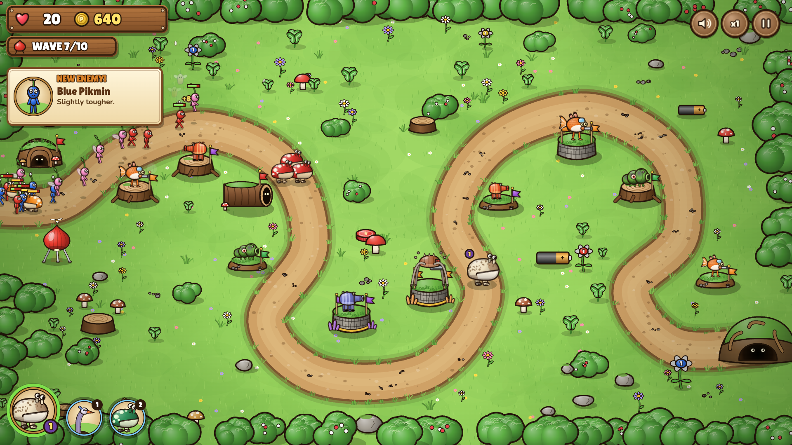

**Twilight Hollow.** The night finale, with Glow Pikmin, fireflies, glowing mushrooms and the President's boss bar.

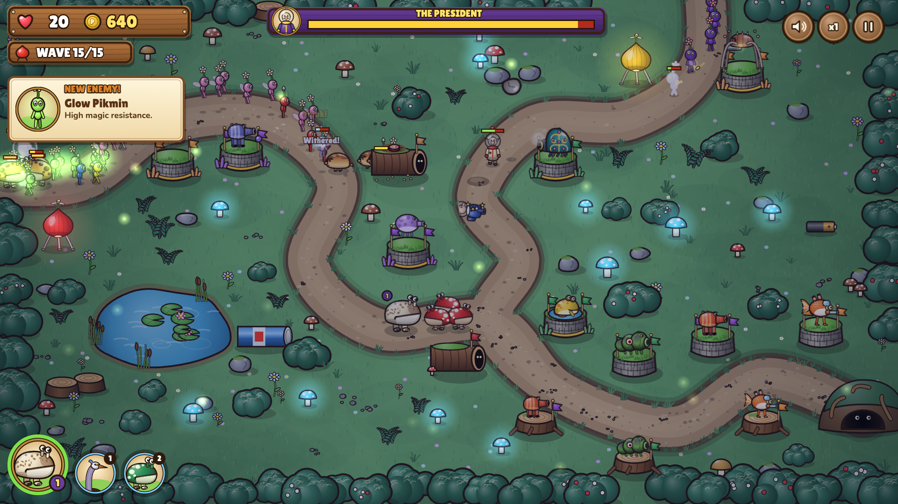

| Title screen | World map |
| --- | --- |
| 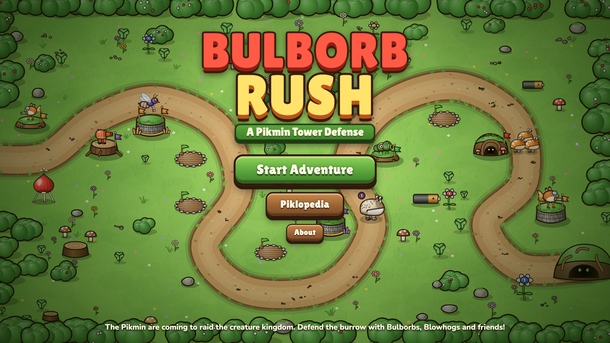 | 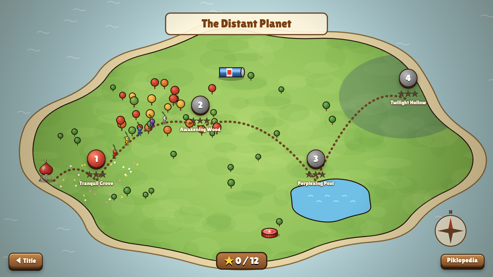 |
| **Awakening Wood** | **Perplexing Pool** |
| 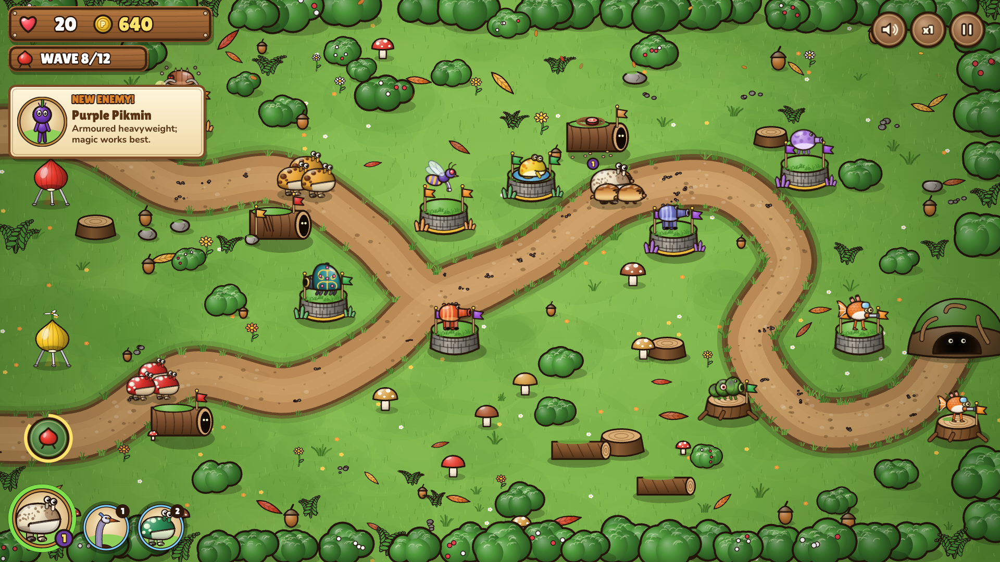 | 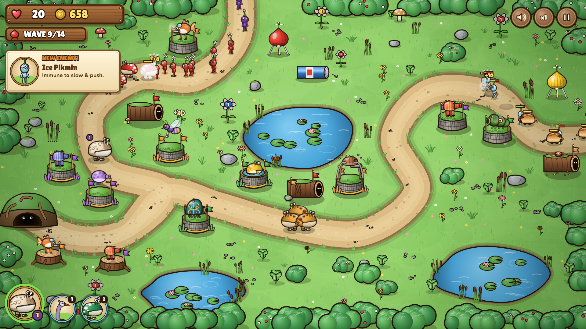 |

### Enemies: Pikmin and captains

Each of the 9 Pikmin types has leaf, bud and flower versions, drawn side-on, from the front and from behind.

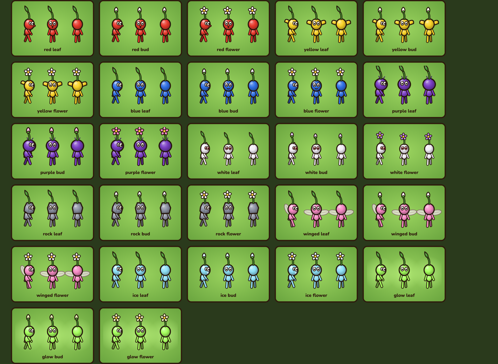

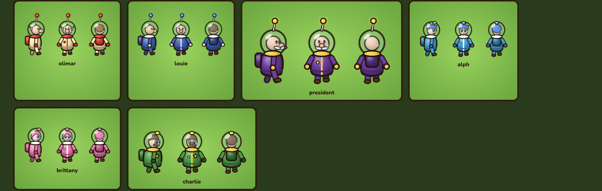

### Towers: native creatures

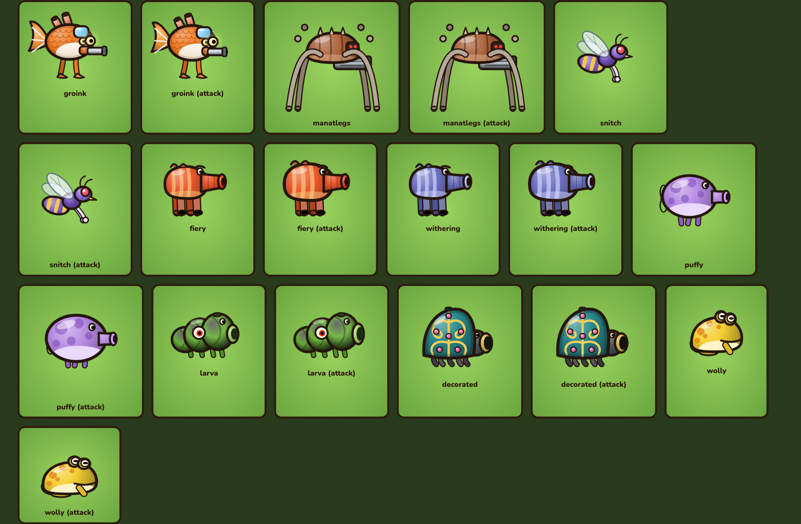

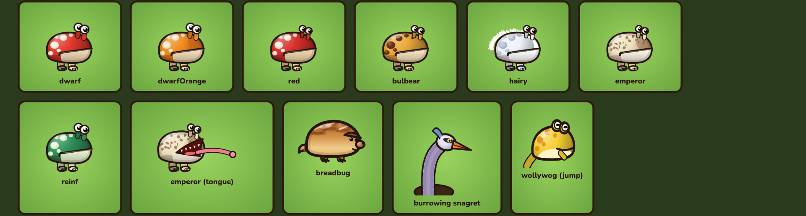

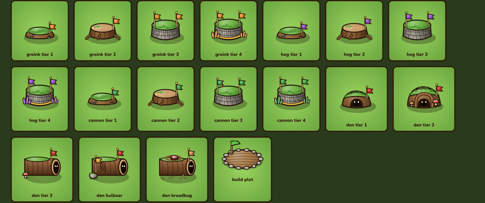

### Props

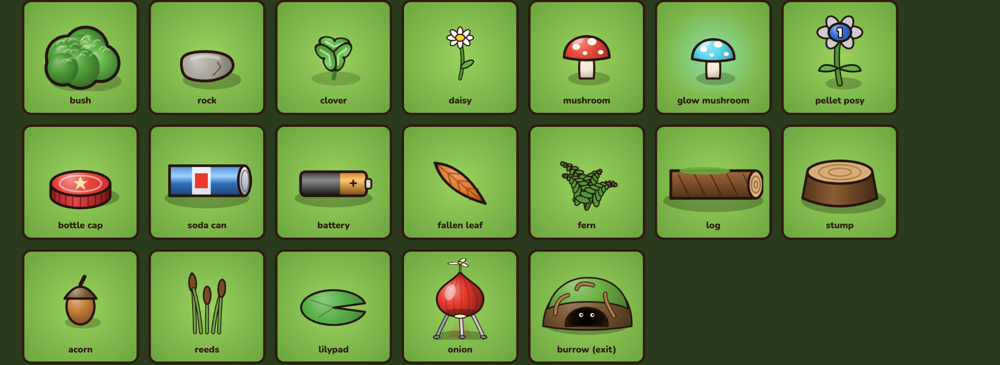

## Run

Open `index.html` in a browser. It uses plain `<script>` tags with no build step, so it also works straight from `file://`.
You can also serve the folder: `python3 -m http.server` → http://localhost:8000

- `assets.html` is a gallery of every generated sprite, prop, icon and map. It has a "Download all as PNG" button.
- `node tools/sim.js [casual|normal|veteran] [smart|mixed]` runs a headless balance simulation with a bot player.

## Contents

- **4 levels** on a world map, each with its own theme: Tranquil Grove (meadow), Awakening Wood (autumn forest, 2 trails), Perplexing Pool (ponds, Koppaites), Twilight Hollow (night, fireflies, President boss). They have 10–15 waves each. Stars are saved in localStorage, and there are three difficulty settings.
- **4 tower families** with 3 upgrade tiers and 2 elite branches each:
  - Gatling Groink (ranged) → Man-at-Legs (gatling bursts) / Swooping Snitchbug (snatches a Pikmin and drops it back down the trail)
  - Bulborb Den (blockers) → Spotty Bulbear Lair (tanks) / Breadbug Burrow (drags Pikmin into the burrow)
  - Fiery Blowhog (magic, burn) → Withering Blowhog (slows, withers flowers back to leaves) / Puffy Blowhog (gusts that push enemies back)
  - Cannon Beetle Larva (artillery) → Decorated Cannon Beetle (rolling boulder) / Yellow Wollywog Pond (belly-flop stun)
- **Hero:** Emperor Bulblax. You can move him around; he has Tongue Lash and Earthquake and levels up to 5.
- **Spells:** Snagret Strike and Bulborb Reinforcements.
- **15 enemy types:** 9 Pikmin types (Red, Yellow, Blue, Purple, White, Rock, Winged, Ice, Glow), each in leaf, bud and flower tiers, plus 6 captains with special abilities (whistle buffs, snack-heal, plucking sprouts, juice heal, armour, boss summons).
- Also included: call waves early for bonus pokos, Piklopedia almanac, "new enemy" cards, pause menu, and synthesized music and SFX.

**Controls:** click plots to build and click towers to upgrade or sell. Space pause · F speed · 1/2 spells · H hero · N next wave · M mute · Esc cancel.

Pikmin is a Nintendo trademark; this is a non-commercial fan project. Creature designs were drawn from public descriptions (Pikipedia / Pikmin Wiki); no game assets were copied.
