# Bulborb Rush: A Pikmin Tower Defense (React Edition)

A Kingdom Rush–style tower defense game set in the world of Pikmin, with the roles reversed. You command the native creatures (Bulborbs, Breadbugs, Blowhogs, Groinks, Cannon Beetles and more). The Pikmin and their captains (Olimar, Louie, Alph, Brittany, Charlie and the President), joined by the Rescue Corps and a Leafling army, are the invaders.

All art and audio are generated procedurally at runtime with Canvas 2D vector drawing and Web Audio synthesis. The application is built with React, TypeScript, and Vite.

## Screenshots

**Tranquil Grove.** A Pikmin column marches in from the Onion while Groinks, Blowhogs, Cannon Beetles and Bulborb dens hold the trail.

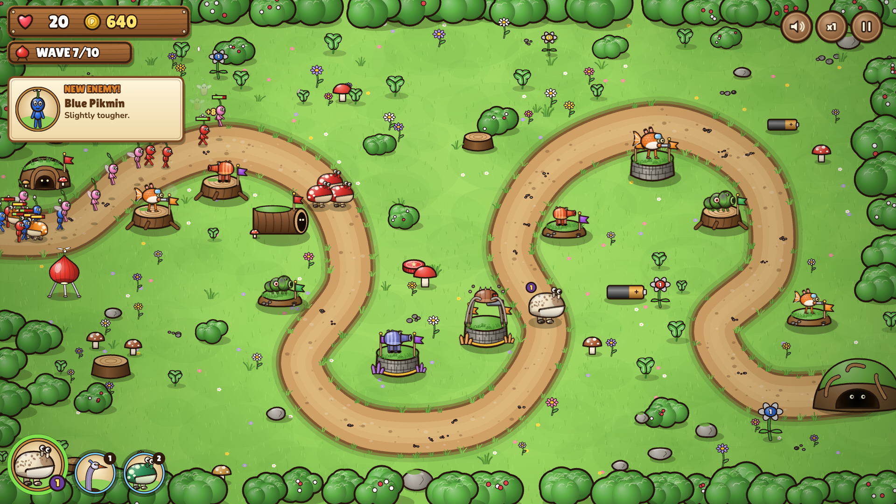

**Twilight Hollow.** The night finale, with Glow Pikmin, fireflies, glowing mushrooms and the President's boss bar.

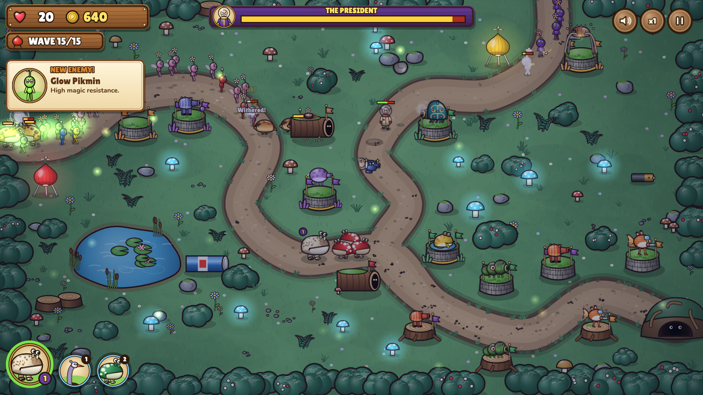

| Title screen | World map |
| --- | --- |
| 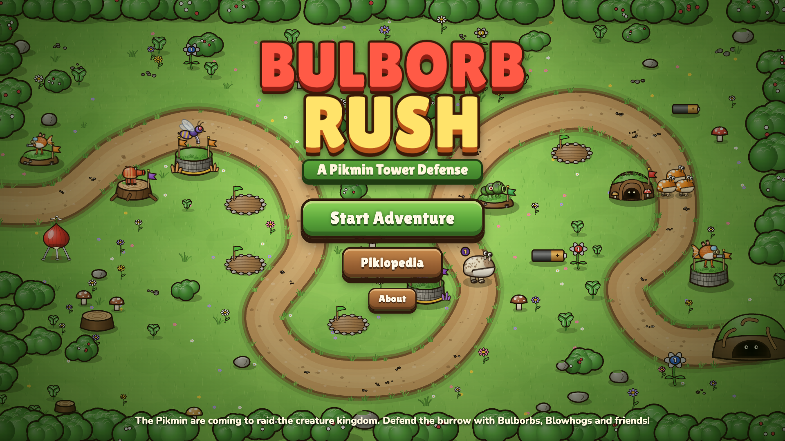 | 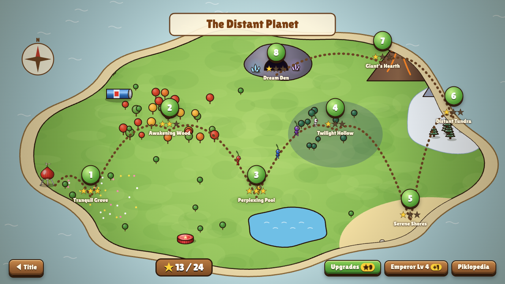 |
| **Awakening Wood** | **Perplexing Pool** |
| 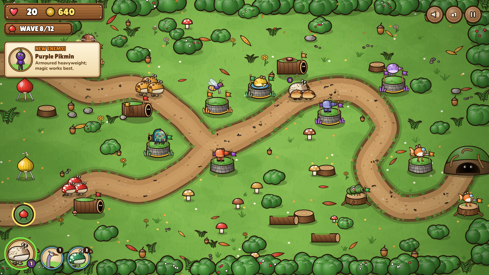 | 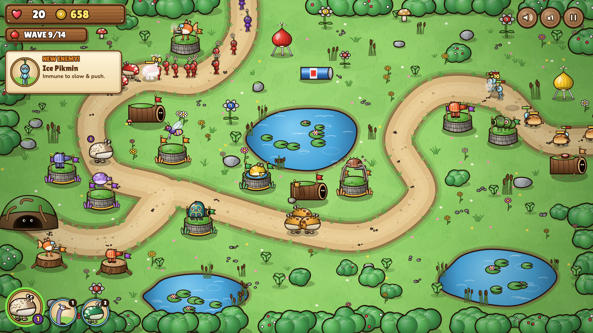 |
| **Serene Shores** (tide pools) | **Distant Tundra** (ice patches) |
| 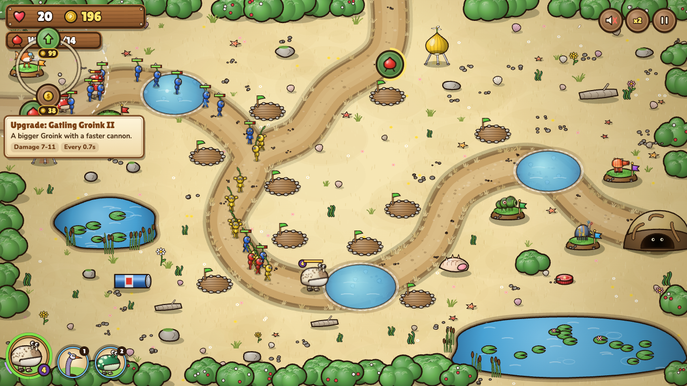 | 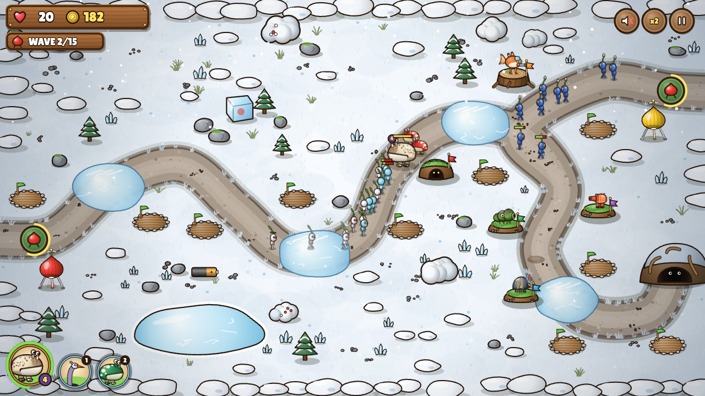 |
| **Giant's Hearth** (lava vents) | **Dream Den** (dark zones, finale) |
| 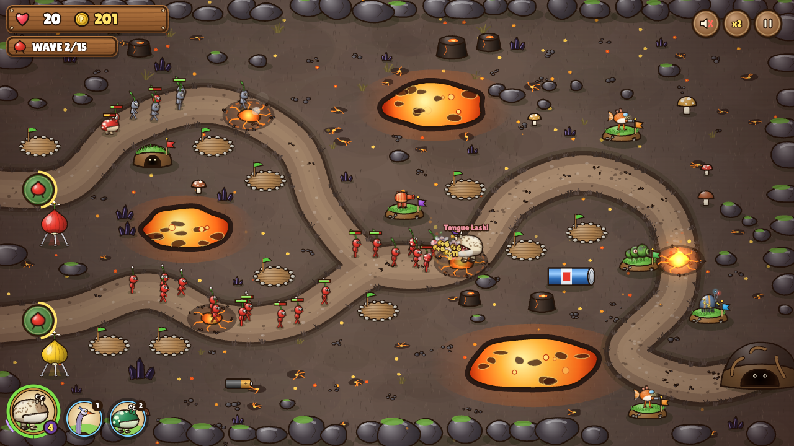 | 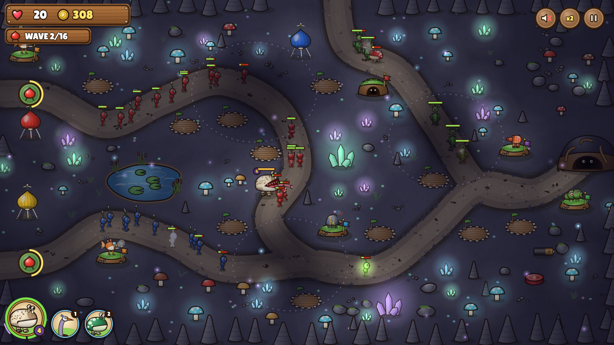 |
| **Star upgrade tree** | **Emperor skills** |
| 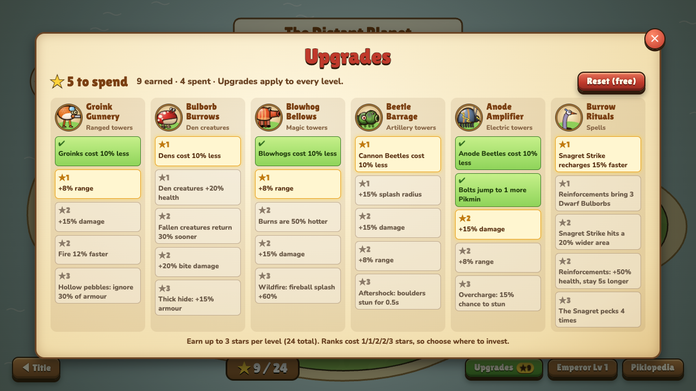 | 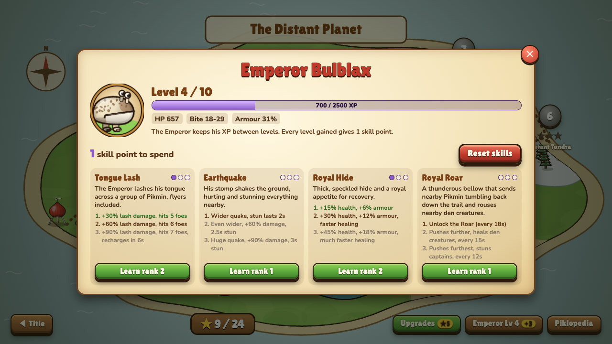 |

**New creatures:** Bulbmin, Collin, Leaflings, Leafling Louie and Oatchi (invaders), plus the Electric family: Anode Beetle, Anode Dweevil and Arachnode.

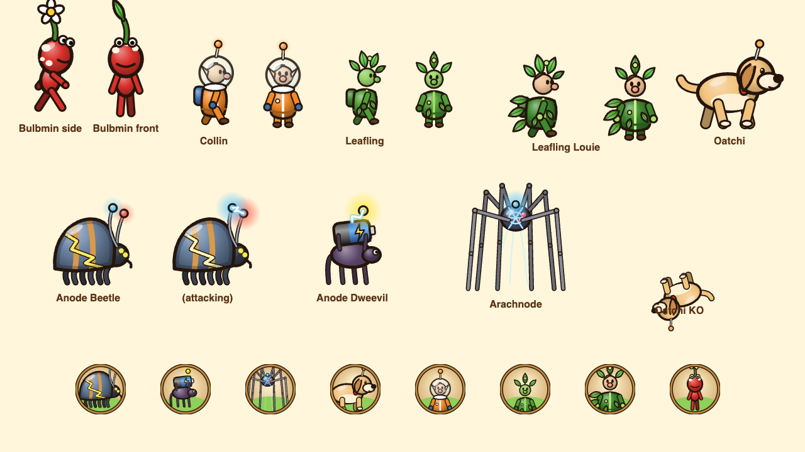

## Development & Run

This project runs on Node.js with Vite:

```bash
# Install dependencies
npm install

# Run the development server (port 3000)
npm run dev

# Build for production
npm run build

# Headless balance check: an auto-player tries all 8 levels with typical progression
npm run test:sim
```

## Features

- **React Architecture**: Modular components for screens (Title, World Map, Game canvas view) and modals (Briefing, Piklopedia Almanac, Upgrades, Emperor, Pause, Results, and About).
- **Procedural Canvas 2D Engine**: All creatures, animations, environments, shadows, effects, and map geography are procedurally rendered without external image files.
- **Synthesized Audio Engine**: Real-time generative music for every theme (Title, Map, Meadow, Forest, Pool, Twilight, Beach, Tundra, Volcanic, Cave) and procedural sound effects via the Web Audio API.
- **8 Levels**, each unlocked by clearing the previous one:
  1. Tranquil Grove (Meadow)
  2. Awakening Wood (Autumn Forest, two trails)
  3. Perplexing Pool (Ponds, Koppaites)
  4. Twilight Hollow (Night, Glow Pikmin, the President boss)
  5. Serene Shores (Beach). **Tide pools** rise and fall. At high tide the flooded trail slows Pikmin, but Blue Pikmin swim faster. Collin arrives.
  6. Distant Tundra (Snow). **Ice patches** make Pikmin slide 40% faster. Oatchi arrives.
  7. Giant's Hearth (Volcanic cavern). **Lava vents** erupt every few seconds and burn anything on them, including your den creatures and the Emperor. Leaflings and Bulbmin arrive.
  8. Dream Den (Underground cave, three trails). **Dark zones** cut the range of towers built inside them by 25%. Final boss: **Leafling Louie**.
- **Towers & Upgrades**: 5 tower families: Gatling Groink (Ranged), Bulborb Den, Fiery Blowhog (Magic), Cannon Beetle Larva (Artillery) and **Anode Beetle (Electric)**. Each has 3 tiers and two elite tier-4 forms. Electric bolts chain between Pikmin and ignore armour, but Yellow Pikmin are immune. The Electric elites are the **Anode Dweevil** (long storm chains that can stun) and the **Arachnode** (strings electric webs across the trail).
- **Invaders**: 10 Pikmin types (including tough cave **Bulbmin**), captains Olimar, Louie, Alph, Brittany, Charlie and **Collin** (rallies nearby Pikmin), the unblockable pup **Oatchi** (frees Pikmin held by dens), **Leaflings** (split in two when knocked down), and two bosses: the President and Leafling Louie.
- **Star Upgrade Tree** (World map, *Upgrades*): spend earned stars on 6 tracks (Groink, Den, Blowhog, Cannon Beetle, Anode Beetle, Spells), each with 5 ranks costing 1/1/2/2/3 stars. Maxing everything costs 54 stars but only 24 can be earned, so you have to choose. Reset is free.
- **Emperor Bulblax Hero**: a movable hero with ground stomps and tongue lashes. His XP and level (up to 10) **carry over between levels**, win or lose. Each level gained gives a skill point to spend on the world map's *Emperor* screen. There are 4 skills with 3 ranks each: Tongue Lash, Earthquake, Royal Hide and Royal Roar.
- **Special Spells**: Snagret Strike (summons a Burrowing Snagret) and Bulborb Reinforcements.
- **Piklopedia (Almanac)**: an interactive compendium with live animated previews and full combat stats for every creature and invader.
- **Persistent Progress**: star ratings, upgrades, hero XP/skills and seen invaders are saved in localStorage. Saves from the 4-level version load unchanged: their stars and seen invaders are kept and can be spent in the new upgrade tree.
